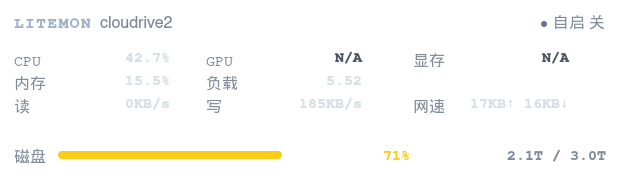

# go-litemon

轻量性能面板，**原生 Qt5 桌面挂件**（QWidget + QPainter 直接绘制，不含任何浏览器/WebEngine）。
透明无边框，浮在 UOS / Deepin / KDE 等 Qt 桌面上，右键菜单可开关开机自启。



## 特性

| 项 | 说明 |
|---|---|
| 渲染方式 | **原生 Qt5 Widgets**（`libQt5Widgets`），无 HTML/JS/WebView |
| 窗口 | 透明背景（`WA_TranslucentBackground`）、无边框、置顶、可拖动、记住位置的最后一帧不落盘 |
| 指标 | CPU%、内存%、负载、读/写速率、网速（↑/↓）、磁盘总空间（单行：进度条 + 百分比 + used/total） |
| 温度 | **不采集、不显示** |
| GPU | 有 `nvidia-smi` 或 AMD `gpu_busy_percent` 时显示 GPU%/显存%，否则 `N/A` |
| 自启 | 右键菜单「开机自启」→ 写/删 `~/.config/autostart/go-litemon.desktop`（XDG，桌面级自启） |
| 采集 | gopsutil（cpu/mem/disk/net）＋ `/sys`，纯 Go，无 cgo 采集依赖 |

## 编译

依赖：Go 1.21+、g++、Qt5 开发包（UOS/Deepin：`libqt5widgets5` + `qt5-devel`/`qtbase5-dev`）、`pkg-config`。

```bash
# Debian/UOS 系
sudo apt install -y g++ pkg-config qtbase5-dev     # 或 dnf install qt5-qtbase-devel

make build          # CGO_ENABLED=1 go build -o go-litemon .
```

产物 `go-litemon` 约 4 MB，**动态链接系统 Qt5**（目标机需有 `libQt5Widgets.so.5`，UOS 桌面默认就有）：

```bash
ldd go-litemon | grep Qt5      # 期望能看到 libQt5Widgets/libQt5Gui/libQt5Core
```

## 运行

```bash
./go-litemon                       # 默认右上角，620x176，2s 刷新
./go-litemon -x 20 -y 20           # 指定位置
./go-litemon -w 700 -h 190         # 自定义尺寸
./go-litemon -interval 1s          # 采集间隔
```

交互：

- **拖动**：按住左键拖动面板；
- **右键**：菜单「开机自启」（勾选即写入 `~/.config/autostart/`）、「退出」。

## 自检（无桌面环境也能验证）

```bash
./go-litemon --dump                # 打印一帧 JSON 指标
QT_QPA_PLATFORM=offscreen ./go-litemon --screenshot out.png   # 离屏渲染一张面板图
```

`screenshot.png` 就是这么生成的（本机 UOS Server 无 X11，用 offscreen 平台渲染）。

## 与旧版（浏览器面板）的差别

| | 旧版 | 现在 |
|---|---|---|
| 形态 | Go HTTP 服务 + HTML/JS 页面 | **单个 Qt 桌面程序** |
| 依赖 | 任意浏览器 | 系统 Qt5 运行库 |
| 自启 | systemd unit（系统级） | `~/.config/autostart/*.desktop`（桌面级） |
| 温度 | 显示 CPU/GPU 温度 | **已移除** |
| 磁盘 | 逐挂载点列表 | **单行总容量** |

## 目录

```
go-litemon/
├── main.go        # 程序入口：Qt 初始化、采集循环、CLI
├── collect.go     # 指标采集（gopsutil + /sys）
├── widget.h       # Go ↔ C++ 的 C ABI
├── widget.cpp     # Qt5 面板绘制、拖动、右键菜单、XDG 自启
├── screenshot.png # 离屏渲染实拍
├── Makefile
└── go.mod / go.sum
```

## License

MIT
